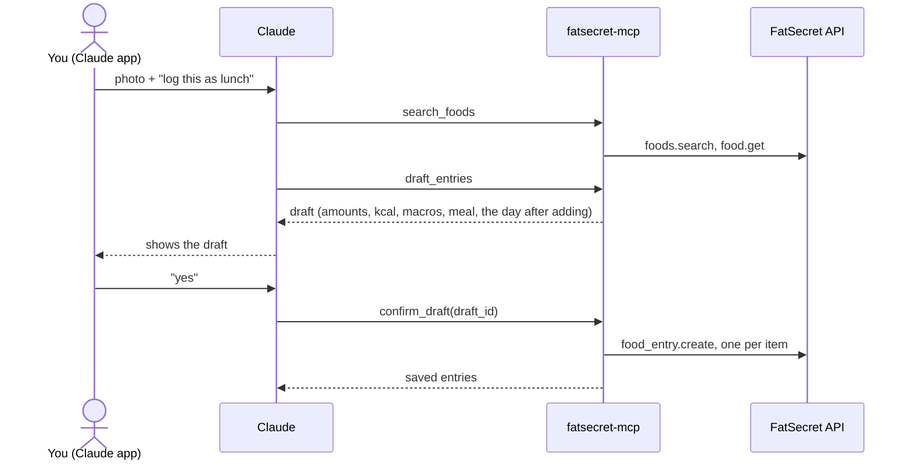
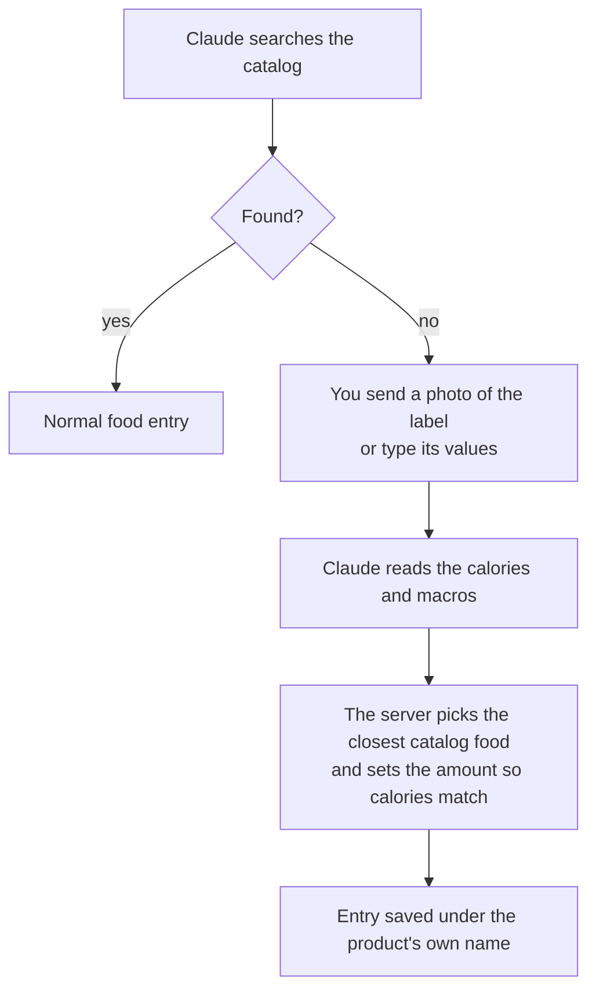
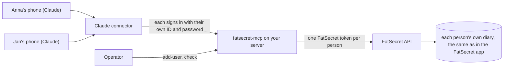

# fatsecret-mcp

<!-- mcp-name: io.github.jaronskijakub/fatsecret-mcp -->

[](https://github.com/jaronskijakub/fatsecret-mcp/actions/workflows/ci.yml)
[](https://pypi.org/project/fatsecret-mcp/)
[](https://github.com/jaronskijakub/fatsecret-mcp/blob/main/pyproject.toml)
[](https://github.com/jaronskijakub/fatsecret-mcp/blob/main/LICENSE)
[](https://github.com/jaronskijakub/fatsecret-mcp/blob/main/docs/connector.md)
[](https://github.com/jaronskijakub/fatsecret-mcp#use-it-with-chatgpt)

Log food to your FatSecret diary by talking to Claude or [ChatGPT](https://github.com/jaronskijakub/fatsecret-mcp#use-it-with-chatgpt) on your phone. You see a draft first, and nothing is saved until you say yes.

https://github.com/user-attachments/assets/44dfd991-5434-47ad-8b84-bcad24415a1f

A photo of dinner, the draft Claude proposes, a "yes", the day so far, and the new entry in the FatSecret app.

fatsecret-mcp is a self-hosted [MCP](https://modelcontextprotocol.io) server. It connects Claude, or ChatGPT when the Operator turns it on, to your own [FatSecret](https://www.fatsecret.com) food diary, the one you see in the FatSecret app. Claude can read a day or a few weeks of it against your daily calorie and macro targets. It can find foods in the FatSecret catalog and draft entries from a description or a photo. Each draft shows the amounts, calories, macros, a suggested meal and how your day looks after adding it. When a packaged product isn't in the catalog, a photo of its nutrition label is enough. A wrong entry can be fixed or removed the same way, through a draft.

One server serves a household: a few people, each signed in with their own FatSecret account. There's no public instance, so you run your own.

This project is unofficial. It is not affiliated with or endorsed by FatSecret, Anthropic or OpenAI, and it is not medical or dietary advice.

[Powered by fatsecret Platform API](https://platform.fatsecret.com)

## What you can ask

The server gives Claude five tools. You never call them yourself; you just talk.

### `search_foods`

Finds foods in the catalog with servings that can be logged.

> **You:** How many calories are in a cup of cooked jasmine rice?
>
> **Claude:** FatSecret has "Jasmine Rice (cooked)": 1 cup (158 g) is 205 kcal, 4.3 g protein, 0.4 g fat, 44.5 g carbohydrate.

### `draft_entries`

Proposes entries without writing anything.

> **You:** *(photo of a plate)* Log this as lunch.
>
> **Claude:** Here's the draft for lunch today:
> - Beef bibimbap, 1 bowl (480 g): 640 kcal, 32 g protein, 21 g fat, 80 g carbohydrate
>
> I assumed one restaurant-sized bowl. After adding it you'll be at 1,420 of 2,200 kcal and 78 of 140 g protein. Save it?

### `confirm_draft`

Writes the draft you approved.

> **You:** Yes.
>
> **Claude:** Saved. Beef bibimbap is in your FatSecret diary under lunch.

### `get_diary_day`

Reads one day with its totals and what's left of your targets.

> **You:** How much is left today?
>
> **Claude:** You've had 1,420 kcal. 780 kcal are left, along with 62 g protein, 18 g fat and 95 g carbohydrate.

### `get_period_summary`

Reads daily totals for up to 31 days.

> **You:** How did my week go compared with the week before?
>
> **Claude:** This week you averaged 2,050 kcal and 128 g protein a day; last week 2,240 kcal and 117 g protein. You went over your calorie target on two days this week, and on four the week before.

The numbers above are illustrative.

## How a meal gets logged



The draft is signed by the server and expires after thirty minutes. It can only be confirmed by the person it was made for. In Claude's connector settings, keep `confirm_draft` on "Needs approval" so that every write asks you first.

## Products the catalog doesn't have

A free FatSecret API key reaches only the US catalog, in English. Most local and branded products aren't in it. For those, Claude asks for a photo of the nutrition label, or you type its values. The server logs the product as a stand-in: the closest catalog food, in the amount whose calories match the label, under the product's own name.



Calories match the label exactly, but macros are only close, and sometimes noticeably off. This comes from translating a product outside the US catalog into a US one. A diary entry can't carry its own calories or macros; it only points at a catalog food and takes that food's values. A free key can't create foods, so the server picks the US food whose macros are nearest to the label. Your product's exact macros usually exist nowhere in the US catalog, so there's nothing closer to pick. The draft shows the label's values, the logged ones and the difference before you confirm, and opening the entry's details in the FatSecret app shows the catalog food underneath.

The server rejects a label whose calories don't roughly agree with its macros, which catches a misread photo or kJ taken for kcal. It doesn't remember stand-ins: next time, Claude reuses the label from the conversation or asks again. Repeating a stand-in from your diary keeps its name and its approximate macros.

If you log a product often, adding it once in the FatSecret app gives you exact values there. After that, Claude can repeat it from your diary.

## Repeat an earlier meal

> **You:** The same as yesterday's breakfast.
>
> **Claude:** Yesterday's breakfast was:
> - Rolled oats, 80 g: 300 kcal
> - 2% milk, 250 ml: 125 kcal
> - Greek yoghurt, 150 g: 90 kcal
>
> Was it all the same today, or should I leave something out or change an amount?
>
> **You:** Without the yoghurt, and half the milk.
>
> **Claude:** Here's the draft, repeated from yesterday: rolled oats, 80 g, and 2% milk, 125 ml, 362 kcal in all. Should it go under breakfast today? Then I'll save it.

Claude reads the earlier day and drafts the entries you keep, without searching the catalog. The server copies each entry's food, serving, name and nutrition from your diary and scales them when you change an amount, always shown in grams or ml. It also works for products the catalog can't return, such as ones you added in the FatSecret app, and for stand-ins, which keep the product's name and don't need the label again. An amount that wasn't logged in grams or ml, such as "2 slices", is looked up once to show it in grams; when no weight is known, the entry is repeated as it was.

## Fix or undo an entry

> **You:** *(right after saving)* Undo that.
>
> **Claude:** Here's the draft: remove beef bibimbap, 1 bowl (480 g), 640 kcal, from today's lunch. You'd be back at 780 of 2,200 kcal. A removed entry can't be restored, only logged again. Remove it?
>
> **You:** Actually, keep it, it was just 300 g.
>
> **Claude:** Here's the new draft: beef bibimbap, 1 bowl (480 g) → 300 g, 640 → 400 kcal, still under lunch. Save the change?

A draft can also change entries already in your diary, including ones you logged in the FatSecret app: a new amount in grams or ml, another meal on the same day, or a new name. It can remove them too. Each change shows the entry before and after, and how each day looks afterwards. Nothing changes until you say yes. For "undo that", Claude removes the entries the last save wrote. For anything else, it reads the day first and asks when it's unclear which entry you mean.

FatSecret can't move an entry to another food or another day. So "it was chicken thigh, not breast" or "that was yesterday" becomes one draft that adds the right entry and removes the wrong one. The new entry is saved first, so if something fails halfway you see a duplicate rather than a gap. Changes reach back up to a year.

## What it doesn't do

- It can't look up barcodes, regional catalogs such as a Polish one, or custom foods. A free key reaches only the US catalog, so Claude searches it in English. Entries are still saved under the name you used, in your language, with a short note that the food was matched in the US catalog, such as "Kajzerka (katalog USA)"; the draft shows the catalog's name beside it.
- It doesn't track weight, exercise or recipes, only food entries.
- It doesn't serve strangers. There's no public server, and each server has a fixed list of people.

## Run your own

A household server has one **Operator**, the person who deploys it and adds everyone else. Each person in the household signs in to FatSecret once through the Operator, then adds the server to their own Claude account as a custom connector, or to ChatGPT when the Operator turns it on.



You need:

- your own FatSecret Platform API key. Register at [platform.fatsecret.com](https://platform.fatsecret.com); the free Basic plan is enough. Using it means accepting FatSecret's [API terms](https://platform.fatsecret.com/terms). This project ships no keys;
- a container host with HTTPS for the server, such as Railway;
- a Claude or ChatGPT account for each person, with custom connectors available on their plan.

The short path:

1. Create a `.env` with your FatSecret key and a signing key, then run `uvx --env-file .env fatsecret-mcp add-user` once per person ([setup](https://github.com/jaronskijakub/fatsecret-mcp/blob/main/docs/setup.md)).
2. Deploy the image `ghcr.io/jaronskijakub/fatsecret-mcp` with those values ([deploy](https://github.com/jaronskijakub/fatsecret-mcp/blob/main/docs/deploy.md)).
3. In Claude, add `https://<your-server>/mcp` as a custom connector and sign in ([connector](https://github.com/jaronskijakub/fatsecret-mcp/blob/main/docs/connector.md)).

To try it on your own computer first, run it over stdio with Claude Code; [setup](https://github.com/jaronskijakub/fatsecret-mcp/blob/main/docs/setup.md#run-it-with-claude-code) covers that too. Request quotas, pacing and caching are described in [limits](https://github.com/jaronskijakub/fatsecret-mcp/blob/main/docs/limits.md), and the trust model in [SECURITY.md](https://github.com/jaronskijakub/fatsecret-mcp/blob/main/SECURITY.md).

## Use it with ChatGPT

ChatGPT signs in the same way as Claude, with the same user `id` and connector password, and uses the same five tools. It's off by default. The Operator turns it on by setting `FATSECRET_MCP_CLIENTS=claude,chatgpt` and redeploying.

Each person then adds `https://<your-server>/mcp` in ChatGPT as a custom connector. ChatGPT offers custom connectors in developer mode, on some plans only; OpenAI's [developer mode](https://help.openai.com/en/articles/12584461) article lists them. Someone who uses both apps signs in to each one separately, and signing them out ends both ([connector](https://github.com/jaronskijakub/fatsecret-mcp/blob/main/docs/connector.md#add-the-connector-in-chatgpt)). The examples on this page come from Claude.

ChatGPT sometimes stops a confirmed change or removal with "This tool call was blocked by OpenAI's safety checks" before it reaches the server, while adding entries works. Nothing changes in your diary then. Try again in a new chat, or make the change with Claude or in the FatSecret app.

## Documentation

- [Setup](https://github.com/jaronskijakub/fatsecret-mcp/blob/main/docs/setup.md): configuration, adding people, their settings, and running it locally with Claude Code.
- [Deploy](https://github.com/jaronskijakub/fatsecret-mcp/blob/main/docs/deploy.md): Railway, other container hosts, Docker, and building the image yourself.
- [Connector](https://github.com/jaronskijakub/fatsecret-mcp/blob/main/docs/connector.md): adding the server to Claude or ChatGPT, sign-in, and signing someone out.
- [Limits](https://github.com/jaronskijakub/fatsecret-mcp/blob/main/docs/limits.md): the daily quota, pacing, search, drafts and input sizes.
- [Changelog](https://github.com/jaronskijakub/fatsecret-mcp/blob/main/CHANGELOG.md): what changed in each version.

Report vulnerabilities through [SECURITY.md](https://github.com/jaronskijakub/fatsecret-mcp/blob/main/SECURITY.md), which also describes the trust model and what is stored where.

## Roadmap

- Custom foods for users with a FatSecret Premier key, so a branded product can be logged with exact values instead of a stand-in.
- Open Food Facts lookups for products the US catalog lacks, by name or barcode.
- Search your own foods by name. Anything in your diary can already be repeated from the day you logged it, but products you often log aren't searched yet; reading them from your whole diary took too many API requests, so this needs another approach.
- Remember products logged from a label, so a stand-in doesn't need the photo again when it isn't repeated from your diary. This needs persistent storage.
- Native confirmation dialogs in Claude for saving a draft, instead of a "yes" in the chat.

## Development

```sh
uv sync
uv run ruff check && uv run ruff format --check
uv run pyright
uv run pytest
```

The tests never call FatSecret. They replay recorded responses from `tests/fixtures/fatsecret/`. An opt-in smoke test reads your real diary: `FATSECRET_LIVE_SMOKE=1 uv run --env-file .env pytest tests/test_live_smoke.py`. Container tests are described in [deploy](https://github.com/jaronskijakub/fatsecret-mcp/blob/main/docs/deploy.md#build-and-test-the-image).

To release a version, set it with `uv version X.Y.Z` and in both places in `server.json`, and give it a dated entry in `CHANGELOG.md`; `tests/test_package.py` checks that they agree. Push that commit to `main` and wait for CI, which publishes its image. Then push the tag `vX.Y.Z`. The release workflow checks that CI passed on `main` for that commit, builds and checks the package, adds the version tag to the commit's image, publishes the package to PyPI and creates the GitHub release from the changelog entry. In a public repository it also publishes `server.json` to the MCP registry.

## License

[MIT](https://github.com/jaronskijakub/fatsecret-mcp/blob/main/LICENSE)
